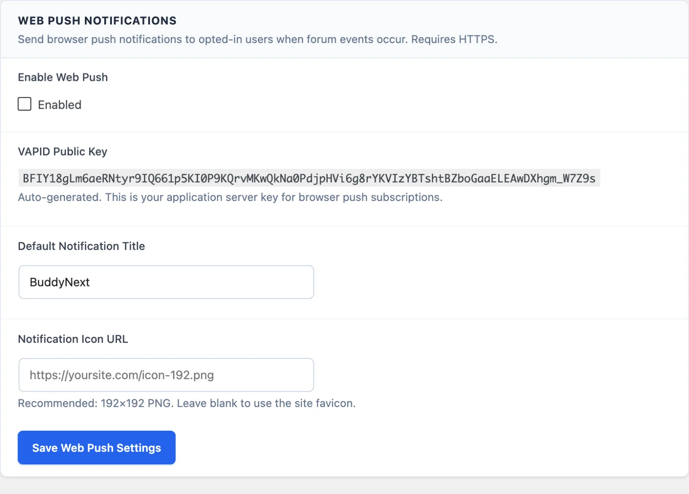

# Web Push Notifications

Reach members with browser push notifications - even when they have closed your site.

> **PRO** - This feature requires [Jetonomy Pro](https://wbcomdesigns.com/downloads/jetonomy-pro/).

## What You Will Learn

- How to turn on Web Push
- How members subscribe to push notifications
- Which events trigger a push notification
- Which browsers are supported

## Why Web Push Matters

Email notifications have open rates around 20-30%. Browser push notifications have open rates above 60% because they appear immediately on the member's screen - no inbox, no subject line, no waiting. For time-sensitive events like a reply to your question or a mention from a teammate, push gets the message there instantly.

## Enabling Web Push

1. Go to **Jetonomy → Extensions** and switch **Web Push Notifications** on. That toggle is the only switch: members see the opt-in straight away.
2. Optional: open **Jetonomy → Settings → Web Push** to set the notification title and icon, then click **Save Web Push Settings**.

Web Push authenticates your server with browsers using a VAPID key pair. Jetonomy creates it automatically the first time the extension runs and shows the public key on the Web Push tab. There is nothing to generate. If it reports that the key could not be generated, your server needs OpenSSL with EC support.

## Service Worker Registration

Jetonomy automatically registers a service worker (`/community/sw.js`) on every community page. You do not need to create or configure the service worker - this happens at extension activation.

The service worker handles:

- Receiving push messages from the Jetonomy server
- Displaying the browser notification
- Opening the correct URL when the notification is clicked

> **Note:** Every push payload is encrypted per [RFC 8291](https://datatracker.ietf.org/doc/html/rfc8291) (aes128gcm content encoding) before it leaves your server, so browsers and push services accept it and its contents are never readable in transit.

Looking for push on a native iOS or Android app instead of the browser? The same extension registers app devices for native push - see [Native push setup](../mobile-app/04-native-push-setup.md).

## Member Subscription

The first time a logged-in member visits any community page after you enable Web Push, a **Enable push notifications** prompt appears at the top of the page. Clicking **Enable** triggers the browser's native permission dialog.

Members who grant permission are subscribed automatically. Their subscription is stored in the Jetonomy database and associated with their account.

Members can unsubscribe at any time from **Profile → Notification Settings → Push Notifications → Off**.

> **Note:** The browser permission prompt can only be triggered by a user action (a click). Jetonomy waits for the member to interact with the prompt banner before requesting permission - it never requests permission automatically on page load.

## Notification Events

Push notifications are sent for the same events that trigger bell notifications, based on each member's preferences:

| Event | Who receives a push |
|-------|---------------------|
| **New reply on your topic** | Topic author |
| **New reply in a topic you follow** | Followers |
| **You are mentioned** | Mentioned member |
| **Your answer is accepted** | Answer author |
| **New message received** | Message recipient (Private Messaging Pro) |
| **Badge awarded** | Badge recipient |

Members control which of these events trigger a push in **Profile → Notification Settings**.

## Browser Support

Web Push works on all major modern browsers without any app installation:

| Browser | Desktop | Mobile |
|---------|---------|--------|
| Chrome | Yes | Yes (Android) |
| Edge | Yes | Yes (Android) |
| Firefox | Yes | Limited |
| Safari | Yes (macOS 13+) | Yes (iOS 16.4+) |

> **Tip:** Safari on iOS requires members to add your site to their Home Screen before push notifications work. This is an Apple platform limitation - not a Jetonomy limitation.

## REST API

Web Push registers these endpoints under `jetonomy/v1`:

| Method | Endpoint | Description |
|--------|----------|-------------|
| `POST` | `/push/subscribe` | Register the current member's browser push subscription |
| `DELETE` | `/push/subscribe` | Remove the current member's push subscription |
| `GET` | `/push/vapid-key` | Fetch the public VAPID key the browser needs to subscribe |
| `GET` | `/push/service-worker.js` | Serve the service worker script |

Subscribe and unsubscribe require the member to be logged in; the VAPID key and service worker are served for the page to register push. See the [REST API reference](../developer-guide/01-rest-api.md) for full payloads.

## What's Next?

Let members reply to community topics directly from their email client.

[Reply by Email →](11-reply-by-email.md)
